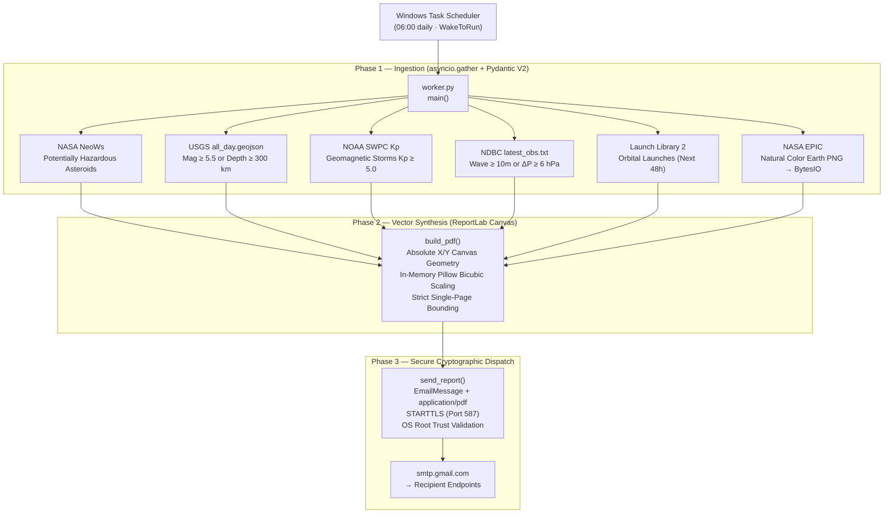

# Planetary Anomaly & Threat Report (PATR)

[](https://github.com/blairmichaelg/planetary-anomaly-report/actions/workflows/ci.yml)
[](https://www.python.org/downloads/)
[-e92063.svg)](https://docs.pydantic.dev/)
[](LICENSE)
[-orange.svg)]()
[](https://google.github.io/styleguide/pyguide.html)

A resilient, local-first background engine that ingests, validates, and synthesizes planetary telemetry—near-Earth asteroids, seismic anomalies, geomagnetic storms, oceanic buoys, and orbital spaceflights—into a publication-quality single-page vector intelligence PDF briefing dispatched via encrypted SMTP.

---

## 🏛️ Executive Summary

Modern cloud automation architectures frequently default to heavy, multi-tier deployments: distributed message queues (Kafka, RabbitMQ), container orchestrators (Docker, Kubernetes), caching layers (Redis), and centralized SaaS monitoring tools. While appropriate for enterprise multi-tenant systems, this pattern introduces unacceptable operational fragility, maintenance overhead, and compute costs for dedicated edge deployments, single-node workstations, and resource-constrained environments.

**PATR was engineered from first principles under strict physical and architectural constraints:**

1. **Local-First & Zero-Broker Footprint**: Operates as a self-contained, single-script engine (`worker.py`) managed directly by OS-level hardware scheduling (Windows Task Scheduler with ACPI hardware wake events). No Docker daemons, no background Redis instances, and no external broker dependencies.
2. **Zero Disk I/O (Silicon Preservation & Security)**: Industrial edge gateways and solid-state devices often suffer from limited NAND write-cycles or operate within ephemeral in-memory filesystems with strict disk quotas. PATR enforces an absolute **zero-disk-write guarantee** for runtime data: HTTP payloads, GeoJSON collections, matrix text feeds, high-resolution satellite imagery transformations, and compiled PDF binaries live and die strictly within volatile memory (`io.BytesIO`).
3. **Deterministic Single-Page Vector Assembly**: ReportLab Platypus flowables (`SimpleDocTemplate`, `KeepTogether`) rely on dynamic reflow engines that predictably suffer from `LayoutError` or multi-page spill when upstream telemetry fluctuates in volume. PATR bypasses high-level document reflow entirely, employing direct cartesian coordinates on a ReportLab `canvas` to mathematically enforce an unyielding, publication-grade dark dashboard.

---

## 🛠️ Tech Stack & Engineering Decisions

| Component | Technology | Architectural Rationale |
|-----------|------------|-------------------------|
| **Core Runtime** | **Python 3.11+** | Native `asyncio` task groups, enhanced exception groups, and high-performance CPython bytecode execution. |
| **Validation Engine** | **Pydantic V2 (Rust Core)** | Employs `pydantic-core` written in Rust. Utilizes `AliasPath` expressions for zero-allocation selective projection—extracting required telemetry keys while immediately dropping bloated nested metadata. |
| **Network Layer** | **HTTPX (`AsyncClient`)** | Concurrent asynchronous non-blocking network I/O with connection pooling, keep-alive, and HTTP/2 readiness. |
| **Fault Resilience** | **Tenacity** | Declarative exponential backoff retries with full jitter (`wait_exponential`) targeting transient 429 rate-limits, 502/503/504 gateway faults, and socket timeouts. |
| **Document Synthesis** | **ReportLab (`pdfgen.canvas`)** | Low-level vector PDF geometry engine. Uses absolute millimeter-based coordinate arithmetic to guarantee a single-page layout without reflow crashes. |
| **Raster Processing** | **Pillow (PIL)** | In-memory image decompression and bicubic thumbnail resampling of multi-megabyte NASA EPIC earth observation PNGs directly in volatile streams. |
| **Storage Architecture** | **Volatile In-Memory Buffers (`io.BytesIO`)** | Strict zero-disk I/O guarantee: all HTTP payloads, intermediate rasters, and synthesized PDF binaries reside strictly in volatile memory, preventing NAND flash wear and eliminating secondary storage footprints. |
| **Security & Dispatch** | **`smtplib` + `ssl`** | Authenticated ESMTP over port 587 with opportunistic STARTTLS, verified against the host OS native certificate trust store. |
| **OS Automation** | **Windows Task Scheduler (XML)** | Native OS integration featuring `<WakeToRun>true</WakeToRun>` to resume sleeping hosts and `<StartWhenAvailable>true</StartWhenAvailable>` to guarantee delivery after downtime. |

---

## 🔄 System Architecture



---

## 📡 Telemetry Sources & Filtration Logic

| Feed | Upstream Endpoint | Extraction & Filter Criteria |
|------|-------------------|-----------------------------|
| **NASA NeoWs** | `api.nasa.gov/neo/rest/v1/feed` | Filtered strictly for `is_potentially_hazardous_asteroid == True`. Extracts name, relative velocity ($\text{km/s}$), and close-approach miss distance ($\text{km}$). |
| **USGS Seismology** | `earthquake.usgs.gov/earthquakes/.../all_day.geojson` | Filtered for Richter Magnitude $M \ge 5.5$ **OR** mantle hypocenter depth $d \ge 300\text{ km}$ (extracted from coordinates index 2). |
| **NOAA SWPC** | `services.swpc.noaa.gov/.../noaa-planetary-k-index.json` | Scans trailing 24 hours of 1-minute planetary indices. Alerts if geomagnetic storm index $Kp \ge 5.0$. |
| **NOAA NDBC** | `www.ndbc.noaa.gov/data/latest_obs/latest_obs.txt` | Ingests space-delimited text matrix. Sanitizes sentinels (`MM`, `99.0`). Filters out DART tsunami buoys. Alerts if significant wave height $h \ge 10\text{ m}$ **OR** rapid barometric pressure drop $\Delta P \ge 6\text{ hPa}$. |
| **Launch Library 2** | `ll.thespacedevs.com/2.3.0/launch/upcoming/` | Extracts orbital launch attempts with Net Earliest Time (NET) falling within the forward $48\text{ h}$ window. |
| **NASA EPIC** | `epic.gsfc.nasa.gov/api/natural` | Fetches latest DSCOVR satellite metadata, computes daily archive paths, and downloads high-resolution natural color Earth imagery directly into memory. |

---

## 🚀 Installation & Quick Start

### 1. Prerequisites
- Python 3.11 or newer
- A Google account with [2-Step Verification](https://myaccount.google.com/security) enabled to generate an [App Password](https://myaccount.google.com/apppasswords).
- (Optional) A free [NASA API Key](https://api.nasa.gov/) (defaults to `DEMO_KEY`).

### 2. Clone & Virtual Environment Setup
```powershell
# Clone the repository
git clone https://github.com/blairmichaelg/planetary-anomaly-report.git
cd planetary-anomaly-report

# Create and activate an isolated virtual environment
python -m venv .venv
.venv\Scripts\Activate.ps1   # On Linux/macOS: source .venv/bin/activate

# Install locked dependencies
pip install -r requirements.txt
```

### 3. Environment Configuration
Copy the template configuration file:
```powershell
Copy-Item .env.example .env
```

Edit `.env` with your preferred editor:
```ini
# ── Gmail SMTP credentials ──────────────────────────────────────────────────
GMAIL_USER=your.address@gmail.com
GMAIL_APP_PASSWORD=xxxx xxxx xxxx xxxx

# ── Report recipients (comma-separated) ─────────────────────────────────────
REPORT_TO=recipient1@example.com,recipient2@example.com

# ── NASA API key (free tier – 1000 req/day) ─────────────────────────────────
NASA_API_KEY=DEMO_KEY

# ── Optional tuning ──────────────────────────────────────────────────────────
EARTHQUAKE_MIN_MAG=5.5
EARTHQUAKE_MIN_DEPTH_KM=300
BUOY_MIN_WAVE_HEIGHT_M=10.0
BUOY_MIN_PRESSURE_DROP_HPA=6.0
KP_STORM_THRESHOLD=5.0
LAUNCH_WINDOW_HOURS=48
```

### 4. Execute Manual Test
Run the worker directly to verify API ingestion, PDF compilation, and email dispatch:
```powershell
python worker.py
```

---

## ⏰ OS-Level Scheduling (Windows Task Scheduler)

The repository provides a production-tuned XML definition in [`task_scheduler.xml`](task_scheduler.xml) designed to run autonomously every day at 06:00 local time.

### Automated Import via PowerShell (Run as Administrator):
Before importing, open `task_scheduler.xml` and replace the three placeholder strings:
- `CHANGE_ME_WINDOWS_USERNAME` &rarr; Your Windows user profile name.
- `CHANGE_ME_PYTHON_PATH` &rarr; Absolute path to `.venv\Scripts\python.exe`.
- `CHANGE_ME_PROJECT_DIR` &rarr; Absolute path to the repository directory.

Register the task:
```powershell
Register-ScheduledTask -Xml (Get-Content ".\task_scheduler.xml" -Raw) `
                       -TaskName "PlanetaryAnomalyReport" `
                       -Force
```

### Key Hardware & Operational Settings:
- `<WakeToRun>true</WakeToRun>`: Instructs the ACPI controller to wake the machine from Sleep or Hibernate states.
- `<StartWhenAvailable>true</StartWhenAvailable>`: If the machine was powered down during the scheduled slot, the task executes immediately upon next boot.
- `<RunOnlyIfNetworkAvailable>true</RunOnlyIfNetworkAvailable>`: Prevents premature execution before Wi-Fi or Ethernet interfaces re-establish connectivity.
- `<RestartOnFailure>`: Automatically retries up to 3 times with 5-minute spacing if upstream network initialisation lags.

---

## 🔒 Security Posture

- **Zero Data-at-Rest**: Because intelligence data and generated PDFs are held exclusively in RAM and garbage-collected upon process termination, no confidential logs or unencrypted PDFs remain on physical media.
- **Root Store Validation**: STARTTLS certificate chains are validated using Python's `ssl.create_default_context()`, which interfaces natively with the Windows CryptoAPI or system OpenSSL root store.
- **Environment Isolation**: `.gitignore` strictly ignores local `.env` files, virtual environment trees, and debug dumps.

---

## 📄 License

Distributed under the MIT License. See `LICENSE` for details.

